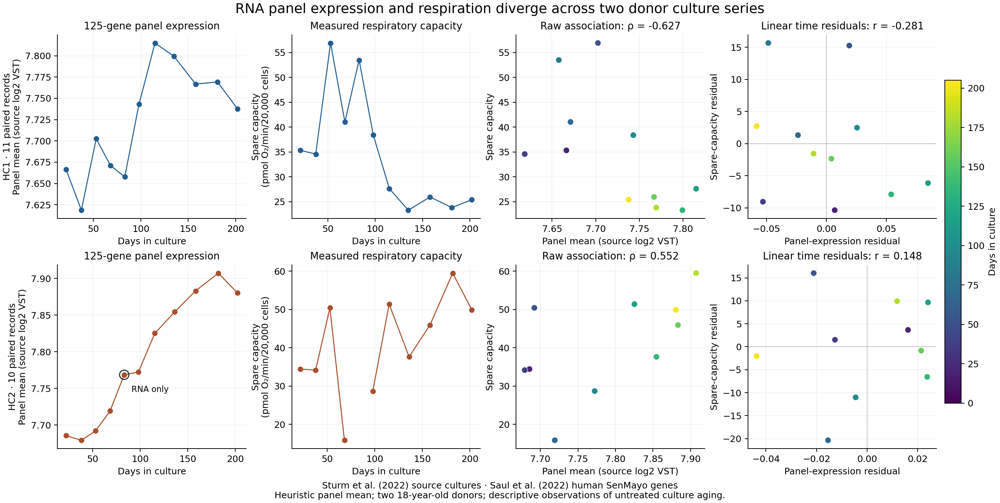

# RNA and respiration diverge across two donor culture series

<!--
Title: RNA and respiration diverge across two donor culture series
-->

**Verified numerical result:** a fixed mean-expression index of 125 human SenMayo genes has opposite raw associations with measured respiratory spare capacity in two untreated fibroblast culture series: Spearman **−0.627 in HC1** and **+0.552 in HC2**. The 21 paired observations come from two 18-year-old donors. This index supplies no common monotonic RNA/function direction across these two series.



[Vector figure](calibration.pdf) · [All coefficients](RESULTS.json) · [All 22 RNA records](sample-scores.tsv) · [Source values for every selected transcript](panel-expression-source.tsv)

The RNA panel comes from [Saul et al. (2022), Supplementary Data 1](https://www.nature.com/articles/s41467-022-32552-1). Its original human list contains exactly 125 unique genes. All 125 occur under their exact symbols in the [Sturm et al. (2022) Cellular Lifespan Study](https://www.nature.com/articles/s41597-022-01852-y) processed [GSE179848 matrix](https://www.ncbi.nlm.nih.gov/geo/query/acc.cgi?acc=GSE179848). The [preceding source intake](../alternative-function-screen-2026-11-01/README.md) established the donor, culture, passage, collection-context and RNA identifiers used here.

**Heuristic biological readout:** “SenMayo-panel mean expression” is the unweighted arithmetic mean of the investigator-provided log2 VST values. It summarizes expression of the published panel. This custom arithmetic is distinct from Saul and colleagues' published enrichment analysis and has no calibration to biological age, senescent-cell number or whole-cell health. All genes have equal weight; the same gene list is used in every sample. The original expression values remain unchanged.

| Description | HC1 | HC2 |
| --- | ---: | ---: |
| Eligible RNA records | 11 | 11 |
| Paired RNA/respiration records | 11 | 10 |
| Raw Spearman, panel versus respiration | −0.627273 | +0.551515 |
| Pearson of linear culture-day residuals | −0.280598 | +0.148333 |
| Pearson of linear passage residuals | −0.258673 | +0.257696 |
| Spearman of consecutive per-day changes | −0.042424 | +0.047619 |
| Consecutive intervals with both measurements | 10 | 8 |

Raw rank correlation and residual Pearson correlation answer different descriptive questions. Residuals remove a separate linear culture-time trend from each variable. That calculation leaves nonlinear time effects and other confounding unresolved. Passage and culture day have identical rank order within each donor; their linear adjustments are reported separately. Consecutive intervals share endpoints and do not supply independent biological replicates.

The panel index rises with culture day in both series, with paired-record Spearman coefficients of +0.700000 and +0.951515. Respiration has different time directions, −0.709091 in HC1 and +0.515152 in HC2. Every leave-one-record-out raw correlation retains its donor's sign: HC1 ranges from −0.696970 to −0.551515; HC2 ranges from +0.383333 to +0.750000. HC2's time-residual correlation spans zero under leave-one-out deletion. All deletions remain visible in [leave-one-out.tsv](leave-one-out.tsv).

These results support keeping donor and culture time explicit when using this particular RNA summary alongside physiology. They provide a bounded challenge to a shared-direction interpretation. They do not establish that the published SenMayo method fails, that a particular donor population behaves similarly, or that senescence causes a change in respiratory capacity. A larger respiratory spare-capacity value has no automatic rejuvenation meaning.

Sample 372 / RNA Sample_36 / GSM5435626 remains RNA-only. Its panel mean is retained among all 22 records. The paired analysis uses the 21 original function values. Neither neighboring functional values nor missing ages are imputed. The two adjacent intervals touching this missing observation are explicitly excluded in [adjacent-changes.tsv](adjacent-changes.tsv), without connecting across the gap. The author-linked culture/passage records describe separate assay aliquots; they establish neither same-cell continuity nor identical assay times.

The [analysis contract](ANALYSIS_CONTRACT.json), original [human panel](senmayo-human.tsv) and [freeze](FREEZE.json) were committed before panel means or associations were computed. The source study and measurements were already available. This is a frozen secondary analysis rather than prospective preregistration or an outcome-blinded experiment. The predefined minimum was 100 of 125 exact genes; observed coverage is 125 of 125, with no aliases, substitutions, gene filtering by association, fitted weights or new normalization.

Original investigators retain credit for the experiment, measurements, gene panel and original biological findings. This package contributes the fixed numerical reanalysis and its checks. Source experiment and panel references use [CC BY 4.0](https://creativecommons.org/licenses/by/4.0/); the extracted human list retains original cell coordinates and is attributed in [REFERENCE_SOURCE.json](REFERENCE_SOURCE.json). Full source archives remain outside this public packet.

The Gill intervention comparison remains deferred with zero joint admissions. Phase 483 continues to require a real supervised external packet. This untreated culture-aging analysis supplies neither rejuvenation efficacy nor safety, identity-retention or persistence evidence.

Offline numerical replay from the released tables, manifest checks and twelve rejection tests:

```sh
python3 programs/partial-reprogramming-controller/benchmarks/sturm-senmayo-calibration-2026-11-01/verify.py
```

Full source replay, after acquiring the matrix pinned in the preceding intake:

```sh
python3 programs/partial-reprogramming-controller/benchmarks/sturm-senmayo-calibration-2026-11-01/analyze.py --sources /path/to/originals
```

The independent checker uses NumPy 2.2.6 and SciPy 1.16.3, imports none of the primary analysis mathematics, and rereads the source matrix. It verifies 2,750 expression strings, 22 means, all 21 original function strings and 56 association coefficients within an absolute tolerance of 1e-10. [INDEPENDENT_CHECK.json](INDEPENDENT_CHECK.json) and [VERIFICATION_RECORD.md](VERIFICATION_RECORD.md) state the verification scope. No p values, population confidence intervals or pooled-donor estimates are reported.
