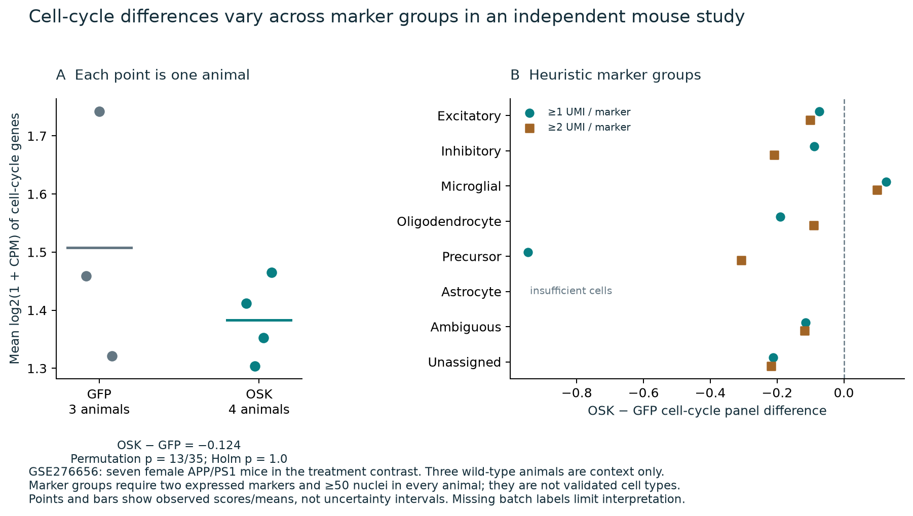

# What persists after reprogramming?

<!--
Title: What persists after reprogramming?
-->

**October 18, 2026.** Public sources supply additional withdrawal observations and an independent mouse expression comparison. They reduce the amount of work that would need to be repeated. The matched late human observation required by the controller remains unresolved: age-related change, adult identity, calibrated unusual-state assessment and recovery must be interpretable together.

**Decision: recover the specific existing inputs before commissioning new measurements. Experiment replacement remains INCONCLUSIVE.** Arithmetic and provenance checks are Verified within their stated scope; biological interpretations are Heuristic. No new wet-lab operations or paid compute were arranged for this analysis.

## What changed

| Evidence | Completed work | Meaning for the next decision |
|---|---|---|
| Human SRSF1 reference outputs | Extracted publisher prediction tables; identified a clear five-days-on/two-days-off comparison with 12 technical rows from three donors. | An existing short withdrawal comparison can be checked. Exact clock replay still requires preprocessing inputs; this does not supply late, joint single-cell recovery. |
| Independent mouse study, GSE276656 | Analyzed ten RNA libraries; the treatment contrast uses four APP/PS1 OSK animals and three APP/PS1 GFP animals. Three wild-type animals provide context. | The pooled cell-cycle estimate is negative and survives the specified sensitivity checks, but is not statistically decisive. Marker groups differ in direction. |
| Xu mouse withdrawal experiment | Reconciled the 2022 dissertation, 2024 publisher supplement and repository history. | A five-day withdrawal experiment already existed. Its omitted named samples still need verified animal/barcode assignments and controls before independent reanalysis. |
| GSE350289 assignments | Re-fetched GEO metadata and compared exact workbook bytes. | The workbook is unchanged. A corrected assignment table remains necessary; expression cannot safely supply missing sample identities. |
| Retinal tAge replication | Kept the model-replay and expression endpoints distinct. | The historical clock pipeline and sample joins remain dependencies. The earlier OSK expression correlation did not test the reported GSTA4 clock-age estimate. |

The human source-data comparison gives an equal-donor mean SRSF1-minus-BFP predicted-age difference of **−10.70 model-years** after two days off. This is arithmetic on published predictions, with three donor lines as the biological units. It is not an independent model replay or a measurement of years of life restored. [Human source audit](human/REPORT.md); [Plesa et al., Nature Aging 2026](https://doi.org/10.1038/s43587-026-01234-8).

[View the three-donor reference figure](figures/human-short-withdrawal-reference.png) · [download PDF](figures/human-short-withdrawal-reference.pdf).

In the independent mouse study, the fixed RNA QC retained **34,210 of 35,907 nuclei** across ten animals. The primary cell-cycle panel difference was **−0.124 mean log2(1 + CPM)**, with an animal-label permutation result of **13/35 = 0.371** and four-test Holm value **1.0**. Missing animal-to-batch labels limit exchangeability. Microglial marker bins have positive differences at both tested thresholds, while the pooled estimate is negative. These are descriptive marker groups, not validated cell identities. [Mouse analysis](ocular/REPORT.md); [Berdugo-Vega et al., Neuron 2026](https://doi.org/10.1016/j.neuron.2025.11.028).

The Xu dissertation establishes a real withdrawal design, but its narrative reports that the elevated neuroblast proportion returned to the old-control baseline after withdrawal. That author-reported observation was encountered during metadata review; it has not been independently recomputed here. It makes the missing data useful for evaluating loss of a response as well as persistence. [Recovery audit](recovery/REPORT.md); [Stanford dissertation](https://purl.stanford.edu/ck834ff5386).

## Where computation stops

The newly admitted expression comparison and published-reference calculations are complete in this packet. Further decisive work requires a changed input: a corrected assignment table, historical clock preprocessing and reference values, or a verified withdrawal dataset. Repeating downloads or training a model on inferred identities would not supply those observations.

The four frozen human readouts remain **insufficient_signal**. A different timepoint or species can answer a narrower question without satisfying the frozen benchmark. Conversely, failure to satisfy those benchmark dates does not establish that every broader recovery question requires a new experiment. A finite public-source audit cannot prove that suitable data exist nowhere.

For the intended matched human claim, **new measurement becomes necessary if the required observations cannot be recovered from existing compatible data or material**. Banked material might avoid repeating culture but would still require an assay. A retinal/RPE functional claim needs a relevant ocular system and appropriate functional measurements in addition to the human fibroblast controller benchmark.

- [Exact remaining inputs and decisions](NEXT_STEPS.md)
- [Machine-readable decision](decision.json)
- [Methods and scope](METHODS.md), [failed paths](FAILED_PATHS.md), [independent review](REVIEW.md)
- [Reproduction and checks](REPRODUCTION.md), [source terms](THIRD_PARTY.md)
- [Conditional measurement and funding design](../2026-10-public-data/MEASUREMENT_PLAN.md)

Our contribution is the independently written analysis, reference audit and explicit evidence decision. Original experiments and clock predictions retain their authorship. Private correspondence and raw matrices are excluded from this public packet.
