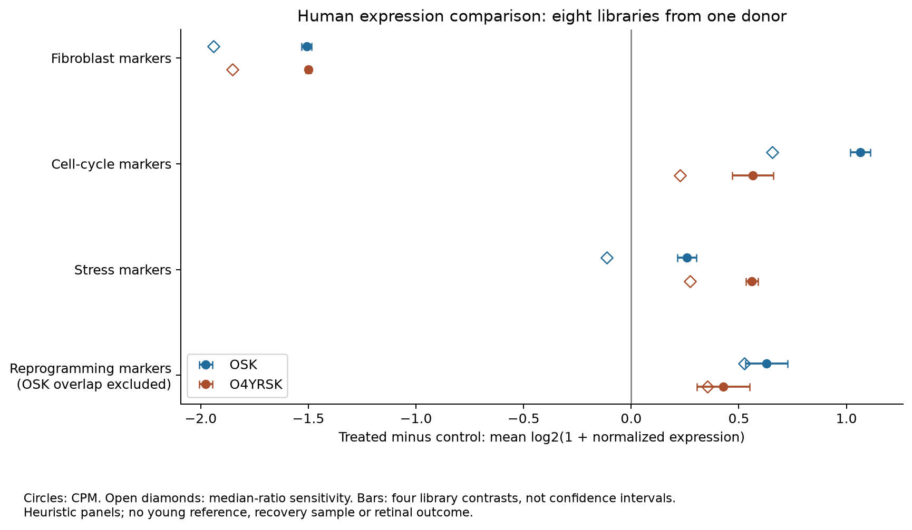
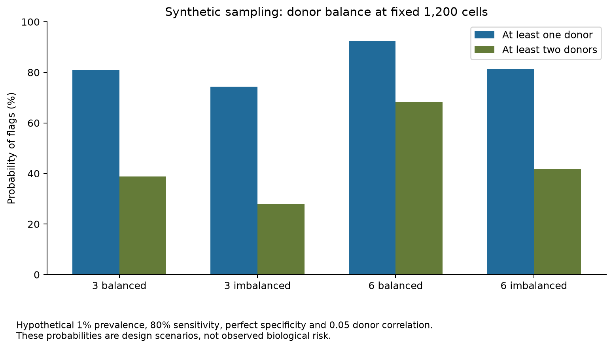

# Expression change and the missing recovery measurement

**Interpretation update, October 18:** the [new marker audit](../2026-10-neural-validation/human/ADDENDUM.md) shows that CD24 supplies most of the human seven-gene score change. The [completed neural analysis](../2026-10-neural-validation/README.md) reports animal sensitivity and additional paired-donor results. The numerical artifacts below remain a historical checkpoint.

<!--
Title: Expression change and the missing recovery measurement
-->

**October 18, 2026 UTC.** The new human comparison shows lower fibroblast-marker expression and higher cell-cycle and reprogramming-marker expression under both normalization methods. A mouse neural deposit now has a verified cell-to-animal mapping. These results expand the usable public evidence while leaving the matched late human recovery measurement open.

Computations and metadata joins are **Verified** within the checks below. Biological interpretations are **Heuristic**. All four CX004 readouts remain `insufficient_signal`; replacing the proposed experiment remains **INCONCLUSIVE**.

## Human comparison

[GSE297233](https://www.ncbi.nlm.nih.gov/geo/query/acc.cgi?acc=GSE297233) contains 62,703 gene rows and eight libraries from one 96-year-old male donor, GM00731. The two libraries per condition do not establish independent donor replication. We reused all four predefined marker panels, mapped all 46 genes through a frozen HGNC snapshot, and added the planned reprogramming-panel sensitivity excluding POU5F1 and SOX2. The source calls the second construct O4YRSK, an OCT4YR mutant plus SK. Original experiment: Tu, Lu and Izpisua Belmonte's deposited study; associated [Cell paper](https://doi.org/10.1016/j.cell.2025.07.031).

Values below are treated-minus-control differences in the mean of log2(1 + normalized expression), rounded to three decimals. They are descriptive panel scores, not calibrated identity probabilities or age changes.

| Fixed panel | OSK: CPM | OSK: median ratio | O4YRSK: CPM | O4YRSK: median ratio |
|---|---:|---:|---:|---:|
| Fibroblast identity markers | -1.508 | -1.940 | -1.500 | -1.851 |
| Cell cycle | +1.064 | +0.656 | +0.564 | +0.226 |
| Stress | +0.258 | -0.113 | +0.561 | +0.274 |
| Reprogramming state, full panel | +1.760 | +1.593 | +1.620 | +1.493 |
| Reprogramming, OSK overlap excluded | +0.628 | +0.527 | +0.427 | +0.354 |

The fibroblast, cycle and reprogramming directions survive both normalizations, all four library comparisons and every single-gene omission. The OSK stress direction reverses with normalization; its median-ratio omission sensitivity also crosses zero. That instability prevents a simple stress-benefit interpretation. Reduced fibroblast ECM-marker expression can reflect program modulation or altered identity; these panels alone cannot distinguish them. The full reprogramming panel includes transcripts introduced by treatment, so its larger change receives no independent validation authority.

This eight-library design has no young reference or recovery arm. It supplies a different-intervention expression comparator, rather than an independent validation of the earlier SRSF1 treatment-recognition model. No age clock, p-value, donor confidence interval, retinal-function estimate or transformation-risk estimate was calculated.



Source columns use `OSK_D0_1` while GEO descriptions use `OSK_0D_1`. The original exact-string join failed. [join-amendment.json](join-amendment.json) records the reversible, outcome-independent alias rule committed before panel calculations. GEO titles still establish a four-day no-dox control; the `D0` token does not establish a day-zero harvest. See [METHODS.md](METHODS.md) and [human-results.json](human-results.json).

## Neural data admission

The [Xu et al. study](https://doi.org/10.1038/s43587-024-00594-3) links [GSE224438](https://www.ncbi.nlm.nih.gov/geo/query/acc.cgi?acc=GSE224438) to [processed Seurat objects on Zenodo](https://doi.org/10.5281/zenodo.10626910). We parsed the cohort-2 object as data, verified its repository checksum, and matched all 3,857 cell records to the raw RNA count columns and the pinned author-code animal map. It contains 31,057 RNA genes and seven animals across three multiplexed libraries.

| Deposited cohort-2 group | Animals | Cells |
|---|---:|---:|
| Old OSKM, treated (`2Dox0`) | 2 | 732 |
| Old OSKM, untreated | 3 | 1,254 |
| Young OSKM, untreated | 2 | 1,871 |

The deposited subset contains zero `2Dox5` withdrawal cells and zero BL6 controls, even though those labels exist in the author code or retained factor levels. Both young animals occur in lane 3. Old treated and untreated animals share lanes 1 and 2; a third old control occurs in lane 3. Four numeric clusters totaling 70 cells have unresolved biological labels. These constraints belong in any future analysis.

**Admission decision:** suitable for a separately frozen animal-level mouse neural expression/composition comparison. Expression contrasts have not yet been run. The metadata inspection is complete; it does not establish a neural treatment effect. [neural-admission.json](neural-admission.json) gives every animal's counts, cell types, lane and source mapping; [NEURAL_NEXT.md](NEURAL_NEXT.md) defines the next decision. Companion GSE245385 was inventoried at the metadata level only.

## Synthetic design extension

The extension tests 48 detection scenarios and 24 all-null false-alarm scenarios at a fixed total of 1,200 cells. Under hypothetical 1% prevalence, 80% sensitivity, perfect specificity and 0.05 latent donor correlation:

| Allocation | At least one donor flagged | At least two donors flagged |
|---|---:|---:|
| 400 / 400 / 400 | 81.0% | 38.8% |
| 1,000 / 100 / 100 | 74.3% | 27.8% |
| 200 each across six donors | 92.5% | 68.2% |
| 1,000 / 40 / 40 / 40 / 40 / 40 | 81.3% | 41.8% |

With no true unusual states, 99.9% specificity and independent errors, the balanced six-donor design still has a 69.9% chance of at least one flagged donor and a 29.9% chance of at least two. Donor-correlated error scenarios are reported separately. A two-donor rule trades sensitivity for fewer false alarms; it cannot establish specificity by itself. These probabilities are hypothetical design diagnostics, not measured biological risks or an experiment-size recommendation.



## Reproduce and inspect

This folder publishes source URLs and hashes, our code, derived results and the fixed analysis contract. Original raw matrices, third-party code and RDS files are fetched from their repositories. See [THIRD_PARTY.md](THIRD_PARTY.md) for attribution and reuse boundaries.

```sh
python3 verify.py
uv run test_analysis.py
python3 fetch_inputs.py input-files.json --cache /path/to/source-cache --receipt /path/to/new-retrieval.json
uv run analyze.py all --cache /path/to/source-cache
uv run inspect_neural.py --cache /path/to/source-cache
python3 run_validation.py --cache /path/to/source-cache
```

The downloader preserves an 8 GB free-space floor, file-size caps and frozen checksums. A changed upstream snapshot fails the hash gate and needs an explicit source revision. The approximately 217 MB cache is temporary and separate from canonical results. Python 3.12 and scientific dependencies are pinned in script headers. The full result replay is byte-identical for all three result JSON files; PDFs and PNGs are outside that byte-level guarantee. The 15 adversarial tests cover identity corruption, missing/ambiguous inputs, count validation, depth invariance and false-alarm boundaries. [VERIFICATION.json](VERIFICATION.json), [TESTS.json](TESTS.json) and [REPRODUCTION.json](REPRODUCTION.json) retain the evidence.

The [presentation addendum](presentation/retinal-comparator-update.pdf) has an [editable PowerPoint](presentation/retinal-comparator-update.pptx) and [plain-text narration](presentation/spoken-notes.txt). [FAILED_PATHS.md](FAILED_PATHS.md) preserves failed assumptions. [NEXT_STEPS.md](NEXT_STEPS.md) connects these results to the remaining measurements and the conditional funding plan.
